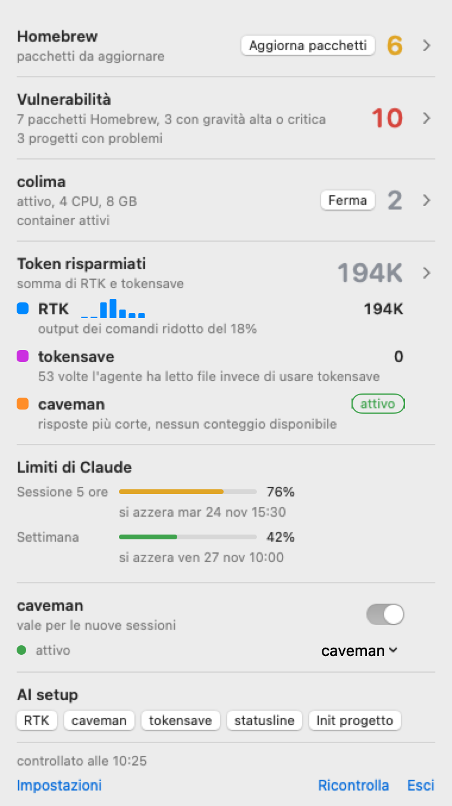

<p align="center">
  
</p>

<p align="center">
  
  
  
  <a href="https://buymeacoffee.com/goeokwihgz"></a>
</p>

**devbar** è una menu bar per macOS che tiene d'occhio il Mac di sviluppo e ti dice quando
c'è qualcosa da sistemare. Un'icona nella barra cambia colore; un clic apre il pannello con
tutto quello che serve, senza aprire il terminale.

<p align="center">
  <picture>
    <source media="(prefers-color-scheme: dark)" srcset="docs/assets/panel-dark.png">
    
  </picture>
</p>

## Perché

Su un Mac di sviluppo le cose si rovinano in silenzio: un pacchetto Homebrew con una
vulnerabilità, colima fermo, un `npm audit` che nessuno lancia, gli strumenti AI da
riconfigurare su ogni harness. devbar le mette in un posto solo, con un numero e un colore, e
per ognuna ti dà il pulsante per sistemarla.

## Cosa fa

| Area | Cosa vedi e cosa puoi fare |
|---|---|
| **Homebrew** | Quanti pacchetti sono da aggiornare; aggiorna tutto o un pacchetto solo. Apre [Cork](https://corkmac.app) se ce l'hai. |
| **Vulnerabilità** | `brew vulns`, `npm audit` e `composer audit` sui repo che scegli tu, una volta al giorno. |
| **Advisory recenti** | Le advisory di sicurezza degli ultimi giorni dal feed di [smzstudio.it/advisories](https://smzstudio.it/advisories/), con ricerca per pacchetto o CVE nei Dettagli. |
| **colima** | Stato, CPU, RAM e container; avvia e ferma. |
| **Token risparmiati** | RTK, tokensave e l'uso di Claude Code in un colpo d'occhio. |
| **Strumenti AI** | Installa e aggiorna RTK, caveman, tokensave, [TokenEconomizer](https://github.com/microsoft/TokenEconomizer) e la statusline su tutti gli harness che trovi (Claude Code, OpenCode, Copilot…). "Init progetto" configura un repo in un clic. |
| **Statusline per Claude Code** | Con i minuti che restano alla prompt cache. |
| **Dettagli** | Tabelle ordinabili in una finestra, non liste che si espandono nel menu. |

<p align="center">
  
</p>

## Installazione

Serve macOS 14 o successivo e [Homebrew](https://brew.sh) con `jq` (`brew install jq`).

Scarica `devbar-x.y.z.zip` dall'[ultima release](https://github.com/savez/devbar/releases/latest), poi:

```bash
unzip devbar-*.zip -d devbar && cd devbar
./install.sh
```

L'icona compare nella barra dei menu e devbar parte da solo a ogni login. Con la GitHub CLI
scarichi e installi in un colpo:

```bash
gh release download --repo savez/devbar --pattern 'devbar-*.zip' && unzip devbar-*.zip -d devbar && cd devbar && ./install.sh
```

**Aggiornare**: stessi passi con lo zip della versione nuova. La configurazione in
`~/.config/devbar` non si tocca. **Disinstallare**: `./install.sh uninstall` (la configurazione resta).

L'app è firmata ad-hoc, senza Developer ID né notarizzazione: `install.sh` toglie la
quarantena di macOS dal bundle installato. Scarica lo zip solo dalle release di questo repo.
Se apri `devbar.app` a mano dallo zip, lancia prima `xattr -dr com.apple.quarantine devbar.app`.
Per installare da sorgente vedi [docs/SVILUPPO.md](docs/SVILUPPO.md).

## Primi passi

1. Apri il pannello dall'icona nella barra dei menu.
2. In **Impostazioni** scegli le cartelle dei tuoi repo: `npm audit` e `composer audit`
   girano solo lì dentro.
3. In **Impostazioni, Controlli automatici** scegli ogni quanto controllare le vulnerabilità (di
   default ogni giorno) e gli aggiornamenti Homebrew (di default ogni 6 ore).
4. Facoltativo: in **Strumenti AI** scegli gli harness che usi e installa quello che ti serve.

## Sicurezza prima di tutto

devbar scrive in file che non sono suoi, quindi lo fa con delle regole:

- **Niente senza conferma**: ogni azione che scrive o installa mostra il piano e chiede il via.
- **Tutto annullabile**: ogni modifica ai file di altri programmi è registrata con un backup. `devbar undo` la riporta com'era, senza sovrascrivere ciò che nel frattempo ha cambiato un altro programma.
- **Nessun server, nessuna telemetria**: i controlli sono comandi locali. L'unica chiamata di rete fatta da devbar stesso è il download del feed pubblico delle advisory da smzstudio.it, senza inviare nessun dato (`brew`, `npm` e `composer` fanno le loro).

Per segnalare una vulnerabilità vedi [SECURITY.md](SECURITY.md).

## Da terminale

Il motore si usa anche senza l'app:

```bash
devbar check all          # tutti i controlli, in JSON
devbar check brew-vulns   # un controllo solo
devbar journal            # le modifiche fatte da devbar
devbar undo               # il piano per annullare l'ultima
```

Comandi, chiavi di configurazione e codici di uscita sono in [docs/RIFERIMENTO.md](docs/RIFERIMENTO.md).

## Problemi noti

**L'icona non si vede.** L'icona parte alla destra della barra, vicino alle icone di sistema.
Se l'hai spostata e non la trovi più, riporta la posizione di partenza e riavvia devbar:

```bash
defaults delete it.savez.devbar "NSStatusItem Preferred Position Item-0"
```

**Hidden Bar la nasconde.** Con Hidden Bar 1.13 devbar può sparire quando la barra si
chiude, anche se è impostata su "Visibile". Non c'è ancora una soluzione: se hai idee, scrivi
nelle [issue](https://github.com/savez/devbar/issues).

## Come funziona

Due parti: un **motore** in bash (`bin/devbar` + `lib/`) che stampa JSON, con tutta la
logica dei controlli, e un'**app** SwiftUI (`app/`) che lo lancia e disegna il risultato. Il
motore si prova da solo; l'app non ha logica di controllo.

## Contribuire

Issue e pull request sono benvenute: leggi [CONTRIBUTING.md](CONTRIBUTING.md). Ogni modifica
a `main` passa da una pull request rivista dal maintainer.

## Supporta il progetto

devbar è gratuito. Se ti è utile, puoi [offrirmi una birra](https://buymeacoffee.com/goeokwihgz); lo trovi anche nelle impostazioni dell'app.

## Licenza e origine

GPLv3, vedi [LICENSE](LICENSE).

- La statusline (`statusline/devbar-claude-statusline`) e il setup di caveman e RTK (`lib/ai/`) sono portati da [Sparkdock](https://github.com/sparkfabrik/sparkdock) (SparkFabrik, GPLv3). I file portati hanno l'intestazione con l'origine; non c'è nessuna dipendenza da Sparkdock a runtime.
- La regola `lib/project/caveman-rule.md` (caveman-init) viene dal plugin [caveman](https://github.com/JuliusBrussee/caveman) (Apache-2.0).
