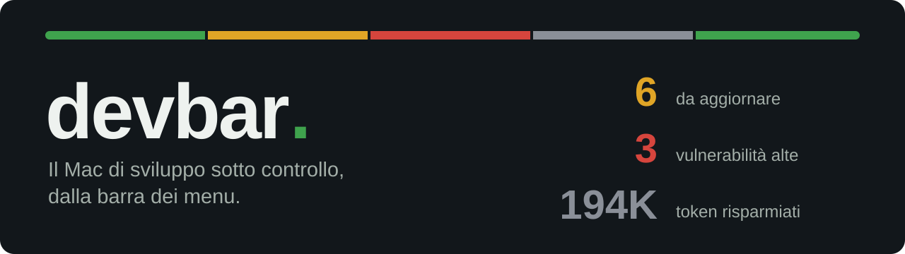
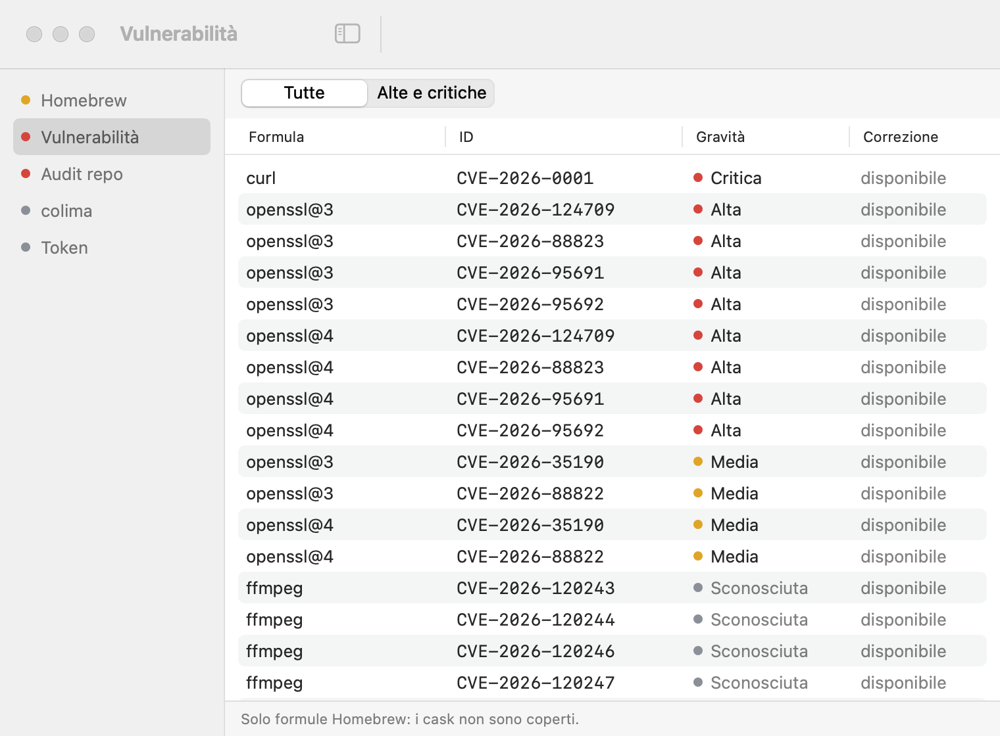

<p align="center">
  
</p>

<p align="center">
  
  
  
  <a href="https://buymeacoffee.com/goeokwihgz"></a>
</p>

**devbar** è una menu bar per macOS che tiene d'occhio il Mac di sviluppo e ti dice quando
c'è qualcosa da sistemare. Un'icona nella barra cambia colore; un clic apre il pannello con
tutto quello che serve, senza aprire il terminale.

<p align="center">
  <picture>
    <source media="(prefers-color-scheme: dark)" srcset="docs/assets/panel-dark.png">
    
  </picture>
</p>

## Cosa fa

- **Homebrew**: quanti pacchetti sono da aggiornare e un pulsante per aggiornarli. Con Cork a portata di mano.
- **Vulnerabilità**: `brew vulns` e `npm audit` / `composer audit` sui repo che scegli tu, una volta al giorno.
- **colima**: stato, CPU, RAM e container, con avvia e ferma.
- **Token risparmiati**: RTK, tokensave e l'uso di Claude Code in un colpo d'occhio.
- **Strumenti AI**: installa e aggiorna RTK, caveman, tokensave e la statusline su tutti gli harness che trovi (Claude Code, OpenCode, Copilot…), e configura un progetto in un clic.
- **Statusline per Claude Code** con i minuti che restano alla prompt cache.
- **Dettagli veri**: tabelle ordinabili in una finestra, non liste che si espandono nel menu.

<p align="center">
  
</p>

## Sicurezza prima di tutto

devbar scrive in file che non sono suoi, quindi lo fa con delle regole:

- **Niente senza conferma**: ogni azione che scrive o installa mostra il piano e chiede il via.
- **Tutto annullabile**: ogni modifica ai file di altri programmi è registrata con un backup. `devbar undo` la riporta com'era, senza sovrascrivere ciò che nel frattempo ha cambiato un altro programma.
- **Nessun server, nessuna telemetria**: i controlli sono comandi locali.

## Installazione rapida

Scarica l'ultima release dagli [asset su GitHub](https://github.com/savez/devbar/releases/latest) (`devbar-x.y.z.zip`), poi:

```bash
unzip devbar-*.zip -d devbar && cd devbar
./install.sh
```

Per aggiornare ripeti gli stessi passi con lo zip nuovo. Dettagli, installazione da sorgente e disinstallazione [più sotto](#installare-e-aggiornare). L'app è firmata ad-hoc: `install.sh` si occupa della quarantena di macOS.

## Come funziona

Due parti:

- **Motore** (`bin/devbar` + `lib/`): bash, stampa JSON su stdout. Tutta la logica dei controlli sta qui.
- **App** (`app/`, SwiftUI): lancia la CLI e disegna il risultato. Nessuna logica di controllo in Swift.

Il motore si usa anche da terminale (`devbar check all`), ed è questo che rende ogni pezzo testabile da solo.

## Supporta il progetto

devbar è gratuito. Se ti è utile, puoi [offrirmi una birra](https://buymeacoffee.com/goeokwihgz); lo trovi anche nelle impostazioni dell'app.

## Contribuire

Issue e pull request sono benvenute: leggi [CONTRIBUTING.md](CONTRIBUTING.md). Per segnalare una vulnerabilità vedi [SECURITY.md](SECURITY.md).

## Licenza

GPLv3, vedi [LICENSE](LICENSE). devbar include codice derivato da [Sparkdock](https://github.com/sparkfabrik/sparkdock) (vedi [Origine](#origine)).

---

## Requisiti

- macOS 14 o successivo
- [Homebrew](https://brew.sh) e `jq` (`brew install jq`); il motore gira con la bash di sistema di macOS (3.2)
- Command Line Tools con Swift (per compilare l'app)
- Per lo sviluppo: `just`, `bats-core`, `shellcheck`, `check-jsonschema` (`brew install check-jsonschema`, valida i contratti JSON)

La statusline per Claude Code (`statusline/devbar-claude-statusline`) richiede bash >= 4.2.

## Installare e aggiornare

L'app porta con sé il motore (`Contents/Resources/engine/`: `bin/`, `lib/`, `statusline/`): non serve il repo per usarla.

### Da release (consigliato)

1. Scaricare `devbar-x.y.z.zip` dagli asset dell'ultima release su GitHub. Con `gh` (se il repo è privato serve l'accesso):
   ```
   gh release download --repo savez/devbar --pattern 'devbar-*.zip'
   ```
2. Scompattare lo zip ed entrare nella cartella (dentro ci sono `devbar.app`, `install.sh` e `LICENSE`).
3. Lanciare `./install.sh`.

**Aggiornare** è la stessa cosa con lo zip della versione nuova: `install.sh` ferma il LaunchAgent, sostituisce `~/Applications/devbar.app` nello stesso posto, e lo riavvia. La config in `~/.config/devbar` non si tocca.

### Da sorgente

```
git pull && just install
```

### Cosa fa `install.sh` (stesso script da zip e da sorgente)

1. rimuove la quarantena dal bundle (`xattr -dr com.apple.quarantine`);
2. copia `devbar.app` in `~/Applications/devbar.app`;
3. crea il symlink `~/.local/bin/devbar` verso `~/Applications/devbar.app/Contents/Resources/engine/bin/devbar`;
4. scrive `~/Library/LaunchAgents/it.savez.devbar.plist` (`RunAtLoad`, `ProcessType Interactive`, `LimitLoadToSessionType Aqua`) e fa `launchctl bootstrap gui/$(id -u)`. Il plist lo genera l'app stessa (`Devbar --print-launch-agent-plist <eseguibile>`): una sola fonte, la stessa che usa l'opzione "Avvio al login" nelle impostazioni.

`just install` compila prima in release (`app/.build/devbar.app`, firma ad-hoc) e poi lancia lo stesso `install.sh`.

### Firma ad-hoc e quarantena

L'app è firmata ad-hoc (`codesign --sign -`): niente Developer ID, niente notarizzazione. Un file scaricato dal browser o da `gh` può portare l'attributo di quarantena, e Gatekeeper rifiuterebbe un'app non notarizzata. Per questo `install.sh` rimuove la quarantena dal bundle installato. Chi apre `devbar.app` a mano dallo zip, senza `install.sh`, deve farlo da sé: `xattr -dr com.apple.quarantine devbar.app`.

### Statusline di Claude Code

Il comando della statusline in `settings.json` usa `DEVBAR_ROOT`, che ora punta dentro l'app installata (`~/Applications/devbar.app/Contents/Resources/engine`). Il percorso resta stabile tra gli aggiornamenti. Chi aveva la statusline puntata al repo rilancia una volta "AI setup, statusline" dall'app.

### Come esce una release

1. i commit su `main` seguono i prefissi conventional (`feat:`, `fix:`, `refactor:`, ...);
2. al merge su `main` il workflow `.github/workflows/release.yml` fa girare release-please (Linux) che apre o aggiorna una PR di release (versione in `version.txt`, `CHANGELOG.md`);
3. il merge di quella PR crea tag e release su GitHub;
4. solo allora parte il job macOS: `just package VERSION=x.y.z` e `gh release upload` di `dist/devbar-x.y.z.zip`.

La pipeline non esegue test (girano in locale: `just test`, `just app-test`). Le action sono fissate allo SHA del commit (`googleapis/release-please-action`, `actions/checkout`; il commento accanto dice la versione), così una versione ripubblicata non può cambiare cosa gira nella pipeline. Dependabot propone gli aggiornamenti con una PR mensile (`.github/dependabot.yml`), SHA e commento compresi.

### Disinstallare

```
./install.sh uninstall   # da zip
just uninstall           # da sorgente
```

Ferma e rimuove app, symlink (solo se punta al motore nel bundle o al repo) e LaunchAgent; la config resta.

L'app ammette una sola istanza (controllo sul bundle id `it.savez.devbar`). All'avvio allinea il plist del LaunchAgent alla chiave `launchAtLogin`.

## Sviluppo

```
just test        # bats (motore)
just lint        # shellcheck
just contract    # rigenera le fixture di contratto dal motore e le valida contro schemas/
just app-test    # swift-testing (XCTest manca nelle Command Line Tools)
just build       # solo il bundle in app/.build/devbar.app
```

## Contratto

Motore (bash) e app (Swift) si scambiano JSON. Il contratto è scritto in `schemas/` (JSON Schema 2020-12, uno per comando, pezzi comuni in `schemas/defs.schema.json`): i campi che l'app legge sono `required` con tipo esatto, i campi extra non sono ammessi. Il motore è la verità: se l'app si aspetta altro, si corregge l'app.

- `tests/contract-fixtures.sh` produce l'output reale di ogni comando con gli stub di `tests/` e una HOME temporanea, anonimizzato, in `app/Tests/DevbarCoreTests/Fixtures/contract/<comando>.json` (le varianti sono `<comando>.<variante>.json`).
- `tests/contract.bats` valida ogni fixture contro il suo schema, ha un caso negativo per ogni schema e fallisce se le fixture registrate non sono quelle che il motore produce ora.
- `app/Tests/DevbarCoreTests/ContractTests.swift` decodifica le stesse fixture con i modelli Swift e verifica che ogni campo usato dall'app sia presente e valorizzato.

Se cambia l'output di un comando: aggiornare lo schema, lanciare `just contract` e committare le fixture.

## Codici di uscita dei check

| Codice | Significato |
|---|---|
| `0` | c'è qualcosa da fare |
| `1` | tutto a posto |
| `2` | errore |
| `3` | non configurato o strumento assente |

Ogni check stampa un solo oggetto JSON su stdout (`status`, `count`, `summary`, `items`, `checkedAt`, ...); log e diagnostica vanno su stderr. `devbar check all` esce sempre `1` e stampa un oggetto con un campo per check (ognuno con `rc`).

## Configurazione

`~/.config/devbar/config.json` (override con `DEVBAR_CONFIG`). Assente o rotta: si usano i default (la rotta dà un avviso su stderr e "config non valida" nelle impostazioni).

| Chiave | Default | Significato |
|---|---|---|
| `repoRoots` | `[]` | cartelle in cui cercare repo (solo lì dentro) |
| `scanDepth` | `4` | profondità massima della scansione (salta `node_modules`, `vendor`, `.git`) |
| `dailyCheckTime` | `"09:00"` | ora del check giornaliero |
| `harnesses` | `[]` | harness AI gestiti |
| `brewExclude` | `[]` | pacchetti Homebrew da ignorare |
| `terminal` | `"Terminal"` | terminale per "apri": `Terminal`, `iTerm`, `Ghostty` |
| `launchAtLogin` | `true` | avvio al login |

Cache in `~/.cache/devbar/` (override `DEVBAR_CACHE_DIR`): vulnerabilità 24 ore, `--force` salta la cache. Un solo `devbar check all` alla volta.

## Comandi

```
devbar check <nome> [--force]
devbar check all [--force]
devbar run <azione> [args...]
devbar detect
devbar repos
devbar journal [--limit N]
devbar undo [<id>] [--yes] [--force]
devbar version
```

Check: `brew-outdated`, `brew-vulns`, `npm-audit`, `composer-audit`, `colima`, `rtk`, `tokensave`, `caveman`, `claude-usage`, `harnesses`.

Azioni (`devbar run ...`): `ai-status <tool>`, `ai-install <tool> <id...>`, `tool-install <tool>`, `project-status <dir>`, `project-apply <dir>`, `brew-upgrade [pkg]`, `brew-exclude <pkg>`, `cork-open`, `cork-install`, `colima-start|colima-stop [profilo]`, `colima-install`, `colima-logs <id>`, `container-stop <id>`, `open-terminal <dir>`.

Le azioni che scrivono o installano senza `--yes` stampano solo il piano. Non esiste nessuna azione "rimuovi".

## Registro delle modifiche e undo

Ogni `devbar run …` che scrive in file di altri programmi (config degli harness, skill, regole, hook, file di un repo) crea una voce in `~/.local/state/devbar/journal/<data>-<id>/` (override `DEVBAR_STATE_DIR`): `meta.json` con i file toccati (hash prima/dopo) e in `files/` la copia di ognuno com'era prima. Config e cache di devbar non vengono registrate. Si tengono le ultime **50** voci; le più vecchie vengono cancellate con i loro backup.

- `devbar journal [--limit N]`: le voci, dalla più recente (in app: Impostazioni, "Ultime modifiche").
- `devbar undo [<id>]`: il piano per annullare la voce (senza id la più recente non annullata). Con `--yes` ripristina i file e toglie quelli creati da devbar.
- Se un file è stato cambiato da un altro programma dopo devbar, il piano lo segnala (`needsForce`) e `--yes` non tocca nulla. Con `--force --yes` si ripristina comunque: la versione dell'altro programma non viene cancellata, resta nella voce in `<voce>/kept/<percorso assoluto>` (mai accanto all'originale) e sparisce quando la voce esce dalla rotazione.

Cosa non si può annullare da devbar:

- `~/.claude.json`: lo scrive `tokensave install` per Claude Code, ma Claude Code lo riscrive a ogni sessione e un undo riporterebbe indietro anche il suo stato. Il piano di `ai-install tokensave claude` lo dice.
- i file scritti da installer esterni (`tokensave install`, `rtk init`, …) fuori dai percorsi noti a devbar: si registrano solo quelli noti (per tokensave il piano dice quali).
- le installazioni Homebrew (`brew upgrade`, `tool-install`, `colima-install`, …).

## Origine

- La statusline (`statusline/devbar-claude-statusline`) e il setup di caveman e RTK (`lib/ai/`) sono portati da [Sparkdock](https://github.com/sparkfabrik/sparkdock) (SparkFabrik, GPLv3). I file portati hanno l'intestazione con l'origine. Nessuna dipendenza dal clone Sparkdock a runtime. La statusline non è più una copia identica (devbar aggiunge, tra l'altro, i minuti alla scadenza della prompt cache) ed è controllata da `just lint` come il resto.
- La regola `lib/project/caveman-rule.md` (caveman-init) viene dal plugin [caveman](https://github.com/JuliusBrussee/caveman) (Apache-2.0).
